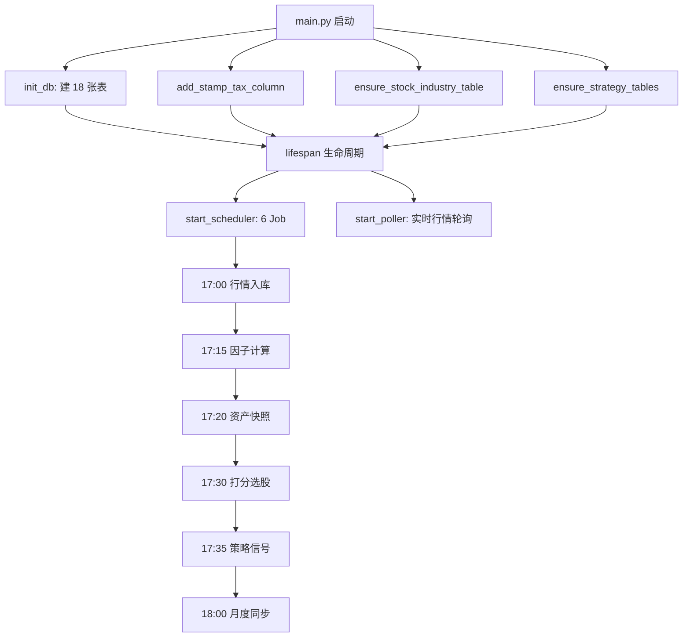

# MyInvestmentSystem 项目审查报告

> 审查日期: 2026-03-11 | 审查范围: 全项目 | 模式: 只读（不修改任何代码）

---

## 1. 项目结构概览

```
myinvestmentsystem/               项目根目录
├── config/
│   ├── scoring.yaml              打分引擎主配置 (11KB, 行业锚点/因子权重/分桶)
│   ├── strategies/
│   │   └── dashu_v1.yaml         大数投资策略规则 (买入/卖出/仓位限制)
│   └── *.csv / *.yaml            打分输出文件与备份
├── scripts/
│   ├── etl/        (11 scripts)  数据采集与清洗
│   ├── scoring/    (7 scripts)   打分、选股、组合构建
│   ├── strategy/   (2 files)     策略引擎核心 (engine.py, 667行)
│   ├── tests/      (2 tests)     归档模块测试
│   └── tools/      (14 scripts)  调试和辅助工具
├── web/
│   ├── backend/                  FastAPI 后端
│   │   ├── main.py               应用入口 (17 Router, lifespan 生命周期)
│   │   ├── database.py           SQLite 建表 (18 张表)
│   │   ├── scheduler.py          APScheduler (6 个定时任务)
│   │   ├── migrate.py            3 个迁移函数
│   │   ├── config.py             路径常量
│   │   ├── response.py           统一响应格式
│   │   ├── utils.py              工具函数
│   │   ├── api/    (17 modules)  按业务拆分的路由
│   │   ├── Dockerfile            后端容器
│   │   └── requirements.txt      12 个 Python 依赖
│   └── frontend/                 Vue 3 + TypeScript 前端
│       └── src/
│           ├── views/   (15 .vue) 页面视图
│           ├── services/ (13 .ts) API 调用层
│           ├── components/        复用组件 (含 Sidebar)
│           ├── composables/       组合式逻辑
│           ├── stores/            Pinia 状态管理
│           ├── router/index.ts    14 条路由
│           └── i18n/              国际化
├── pytdx3/                        Git 子模块 (通达信接口)
├── market.db                      行情数据库 (~3GB, SQLite)
├── user_data.db                   用户数据库 (~1.5MB, SQLite)
├── docker-compose.yml             2 个服务 (backend:8001, frontend:8080)
└── docs/                          项目文档
```

### 核心规模统计

| 维度 | 数量 |
|------|------|
| 后端 API 模块 | 17 |
| 数据库表 (`user_data.db`) | 18 |
| 前端页面 | 15 |
| 前端 Service | 13 |
| ETL 脚本 | 11 |
| 打分脚本 | 7 |
| 定时任务 | 6 |
| 前端路由 | 14 |

---

## 2. 启动方式与依赖关系

### 本地开发

```bash
# 后端 (从项目根目录)
python -m uvicorn web.backend.main:app --reload --port 8000

# 前端
cd web/frontend && npm install && npm run dev
```

### Docker 部署

```bash
cp .env.example .env  # 填入 TUSHARE_TOKEN
docker-compose up -d --build
# 后端: http://localhost:8001  前端: http://localhost:8080
```

### 启动时序依赖



### 技术栈依赖

| 层 | 技术 | 版本约束 |
|---|---|---|
| 后端框架 | FastAPI + Uvicorn | `>=0.109, <1.0` |
| 数据处理 | pandas + numpy | `>=2.0, <3.0` / `>=1.24, <3.0` |
| 数据源 | tushare, akshare, pytdx3 | 多源兜底 |
| 调度器 | APScheduler | `>=3.10.4, <4.0` |
| 前端 | Vue 3 + TypeScript + Vite + Element Plus + ECharts | — |
| 状态管理 | Pinia | — |

---

## 3. 当前主要风险点

### P0 / 高风险

#### 3.1 策略引擎买入价格问题
- **文件**: [engine.py](file:///Volumes/外挂硬盘/ClaudeCode-work/myinvestmentsystem/scripts/strategy/engine.py#L406)
- **问题**: 买入决策中 `current_price = sig.pb` — 直接把 PB 当作股价使用
- **影响**: 买入数量和金额计算完全错误，PB 通常在 0.5~5 之间，而股价可能是 5~100
- **L406-414**: 后续有 `close_price` 兜底检查，但 `stock_pool` 中大概率没有 `close_price` 字段

#### 3.2 未提交的大量改动散落在工作目录
- **当前分支**: `ai-work`（比 `main` 多 1 commit + 大量未暂存的改动）
- **涉及**: `main.py`, `database.py`, `migrate.py`, `scheduler.py`, 以及全部 strategy 相关的新文件
- **风险**: 策略引擎功能是"半完成"状态，既没有 commit 也没有测试验证

#### 3.3 `database.py`与`migrate.py`存在建表重复
- **问题**: `init_db()` 和 `ensure_strategy_tables()` 各自独立创建同一批策略相关表，两处的建表 SQL 略有差异（如 `strategies` 表的 `description` 字段默认值不同）
- **风险**: 如果未来只改一处忘记同步另一处，可能导致表结构不一致

### P1 / 重要

#### 3.4 `get_db_connection()` 泄漏风险
- **文件**: [database.py](file:///Volumes/外挂硬盘/ClaudeCode-work/myinvestmentsystem/web/backend/database.py#L12-L16)
- **问题**: `get_db_connection()` 返回裸连接，调用方需手动 `close()`；在 `scheduler.py` L200-205、L227-234 中也直接使用了此函数
- **建议**: 项目已有 `get_db()` 上下文管理器，但部分代码仍在用 `get_db_connection()`

#### 3.5 `market.db` 写入路径不经过 Docker 卷
- **文件**: `docker-compose.yml`
- **问题**: `market.db` 直接挂载为文件 (`./market.db:/app/market.db`)，但 WAL 文件 (`market.db-shm`, `market.db-wal`) 未挂载
- **风险**: Docker 容器内的 ETL 写入可能因 WAL 文件不同步而导致数据丢失

#### 3.6 测试覆盖严重不足
- **现状**: `scripts/tests/` 仅有 2 个归档测试文件，后端 API 无单元测试，前端仅有 `services.test.ts` 一个测试
- **缺失**: 交易计算、打分引擎、策略引擎等核心逻辑完全没有自动化测试

#### 3.7 策略引擎前端 `UploadCenter.vue` 未注册路由
- **文件**: [router/index.ts](file:///Volumes/外挂硬盘/ClaudeCode-work/myinvestmentsystem/web/frontend/src/router/index.ts)
- **问题**: `UploadCenter.vue` 存在于 `views/` 但路由中没有对应条目（原来的 `/upload` 被重定向到 `/industry`）
- **影响**: 该页面无法通过路由访问

### P2 / 一般

#### 3.8 散落在项目根目录的 CSV/临时文件
- 根目录存在多个分析输出文件：`coverage_report.csv`, `l2_alias_mismatches.csv`, `offenders_*.csv`, `portfolio_suggestion.csv`, `ts_sample_20.csv` 等
- 应归入 `data/` 或 `config/` 目录，或加入 `.gitignore`

#### 3.9 `scoring.yaml` 备份和变体文件泛滥
- `config/` 目录里有 `scoring.yaml.bak`, `scoring_l1_primary.yaml`, `scoring_merged.yaml` 等多个变体
- 容易混淆当前生效的配置版本

#### 3.10 `scheduler.py` 中 `run_daily_strategy` 使用裸模块导入
- **L154**: `import engine as strategy_engine` — 依赖 `sys.path` 中包含 `scripts/strategy`
- 若 `sys.path` 配置有误会导致运行时 ImportError，且不易排查

---

## 4. 建议任务拆分

### 任务 A: 策略引擎完善 🔴 高优先
1. **A1**: 修复 `engine.py` 中买入价格计算 — 用真实收盘价替代 `sig.pb`
2. **A2**: 为 `stock_pool` 表或 `market_data` 增加 `close_price` 字段
3. **A3**: 验证策略引擎端到端流程（信号生成 → 决策 → 写库）
4. **A4**: 为策略引擎编写单元测试

### 任务 B: 数据库一致性治理 🟡 中优先
1. **B1**: 合并 `database.py` 和 `migrate.py` 中重复的建表 SQL，统一管理
2. **B2**: 将所有 `get_db_connection()` 调用替换为 `get_db()` 上下文管理器
3. **B3**: 审查 `market.db` WAL 文件在 Docker 环境下的一致性

### 任务 C: 测试基础设施 🟡 中优先
1. **C1**: 为交易计算逻辑 (`transactions.py`) 编写单元测试
2. **C2**: 为打分引擎 (`scoring.py`) 编写测试
3. **C3**: 确保前端 `npm run test` 能覆盖关键 Service 层

### 任务 D: 代码整理与 Git 提交 🟢 低优先
1. **D1**: 整理根目录散落的 CSV 文件
2. **D2**: 清理 `config/` 中的备份文件
3. **D3**: 将当前 `ai-work` 分支的改动 review 后分批提交
4. **D4**: 修复 `UploadCenter.vue` 路由注册

---

## 5. 优先级排序

| 排序 | 任务 | 级别 | 理由 |
|------|------|------|------|
| 1 | **A1** 修复策略引擎买入价格 | P0 | 直接导致金额计算错误 |
| 2 | **A3** 策略引擎端到端验证 | P0 | 新功能尚未验证，可能存在其他隐藏 bug |
| 3 | **B1** 建表 SQL 去重 | P1 | 两处同一张表定义不同步，已有隐患 |
| 4 | **B2** 连接泄漏防护 | P1 | `get_db_connection()` 泄漏风险 |
| 5 | **C1** 交易计算测试 | P1 | 交易是核心业务，无测试保护 |
| 6 | **A2** `close_price` 字段补充 | P1 | 策略引擎买入决策的数据依赖 |
| 7 | **A4** 策略引擎测试 | P1 | 复杂逻辑需要测试保护 |
| 8 | **B3** Docker WAL 一致性 | P1 | 部署场景的数据安全 |
| 9 | **D3** 分批提交改动 | P2 | 代码卫生 |
| 10 | **D1/D2/D4** 代码整理 | P3 | 可读性和维护性 |

---

## 6. 验收标准

### 策略引擎 (任务 A)
- [ ] `engine.py` 买入决策使用实际收盘价，而非 PB 值
- [ ] `stock_pool` 数据包含 `close_price` 或从 `market.db` 合并最新收盘价
- [ ] 手动触发 `run_strategy()` 后，`strategy_runs` / `strategy_signals` / `strategy_decisions` 三张表有正确数据
- [ ] 买入金额 = 股价 × 数量（非 PB × 数量）
- [ ] 策略引擎单元测试通过，覆盖买入/卖出/仓位限制/现金不足等分支

### 数据库一致性 (任务 B)
- [ ] `database.py` 中所有建表语句是唯一来源
- [ ] `migrate.py` 仅负责列增减和数据迁移，不重复建表
- [ ] `scheduler.py` 中所有数据库操作改用 `get_db()` 上下文管理器
- [ ] Docker 部署下，ETL 写入 `market.db` 后重启容器数据不丢失

### 测试覆盖 (任务 C)
- [ ] `scripts/tests/` 包含交易计算+打分引擎的测试（`pytest` 可通过）
- [ ] 前端 `npm run test` 覆盖策略相关 Service 调用

### 代码整理 (任务 D)
- [ ] 项目根目录不包含分析输出 CSV（已转入 `data/` 或 `.gitignore`）
- [ ] `config/` 中仅保留活跃配置文件
- [ ] `ai-work` 分支改动已 review 后提交为有意义的 commit
- [ ] `UploadCenter.vue` 可通过侧边栏和路由正常访问

---

> [!IMPORTANT]
> **P0 问题**：策略引擎 `engine.py` L406 将 PB 值当作股价计算买入数量和金额，这是当前最严重的逻辑错误，**必须优先修复**。
